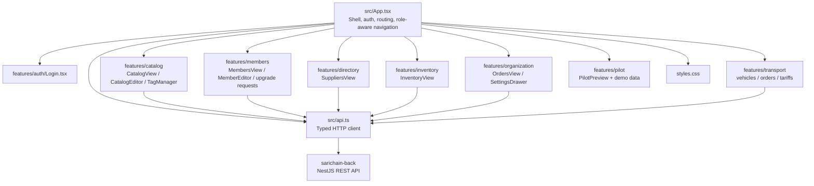

# Sarichain Panel — Knowledge Graph

> Snapshot: `main` | Architecture map for future task handoffs. This is a structural guide, not a replacement for source code.

## Runtime and stack
- React 19 + TypeScript + Vite; RTL admin SPA, light/dark theme.
- Node.js >= 22.12.0. `npm run dev`, `npm run build`.
- Browser API calls go through the Vite/proxy-facing `/api` prefix (configure `BACKEND_URL` for the backend target).
- Live access token and demo flag are held in tab `sessionStorage`; theme preference in `localStorage`.
- Demo mode is read-only and uses local demo data.

## Knowledge graph

## Main feature boundaries
- **Catalog**: products, categories, brands, tags; searchable/paginated lists and editor workflows.
- **Members**: panel users, customers, producers and service providers; profile editing and account-upgrade review.
- **Directory**: published material suppliers for members; management view can include drafts.
- **Organization**: branch/profile settings and branch-scoped orders.
- **Operations**: inventory, transport vehicles, transport orders and zone tariffs; management-only areas.
- **Pilot**: isolated preview/data presentation.

## Producer category-change request review

- `src/api.ts` models `AccountUpgradeRequest.kind` with the additional `producer_categories` variant and carries current/requested category IDs and labels. The existing request-list and review calls are reused:
  - `GET /members/account-upgrades/requests`
  - `PATCH /members/account-upgrades/:id/review`
- `src/features/members/AccountUpgradeRequestsView.tsx` labels this request as a producer category change and displays current categories, requested categories, and the calculated additions/removals. Management/admin users can approve or reject it and include a review note.
- Approval is applied by the backend, not by the panel: the backend replaces the member's `allowedProductCategoryIds` with the requested set. The panel only submits the decision; backend authorization and validation remain authoritative.
- Related producer-side UI and API proxy are in `lllidon/sarichain-web`; request validation and permission mutation are in `lllidon/sarichain-back`. See each repository's `docs/KNOWLEDGE_GRAPH.md` for the full flow.
- Relevant change: panel PR #5 merged to `main`. Rebuild/redeploy the panel for the new request kind and comparison details to appear.

## Authorization model visible in the UI
- `management`: broad access; settings, inventory and transport operations.
- `admin`: member/branch operational scope and account-upgrade review; catalog writes are exposed only when role is management in the catalog view.
- `client`: navigation is forced to orders.
- Backend guards remain authoritative; hiding a UI link is not an authorization boundary.

## Change-impact guide
- Navigation, URL hash sections, session and theme: `src/App.tsx`.
- HTTP routes, request/response types and token headers: `src/api.ts`.
- Feature-specific UX: matching `src/features/<feature>/`.
- Global layout, responsive behavior and theme tokens: `src/styles.css`.
- Backend contract changes must be coordinated with `lllidon/sarichain-back`; public marketplace behavior belongs primarily to `lllidon/sarichain-web`.

## Cross-project links
- Backend: https://github.com/lllidon/sarichain-back
- Public website: https://github.com/lllidon/sarichain-web
